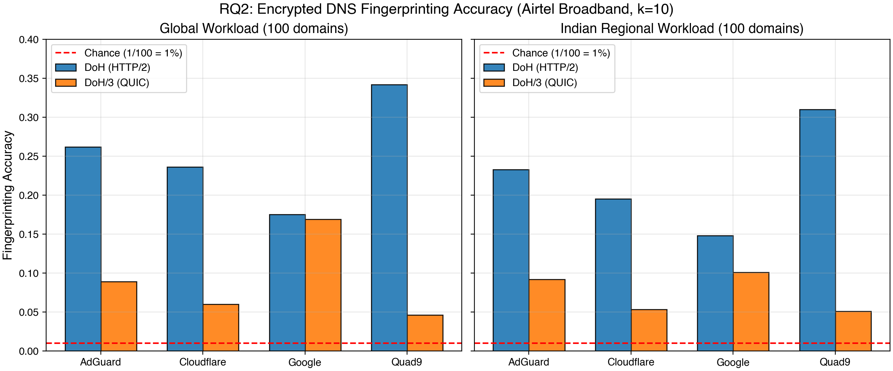
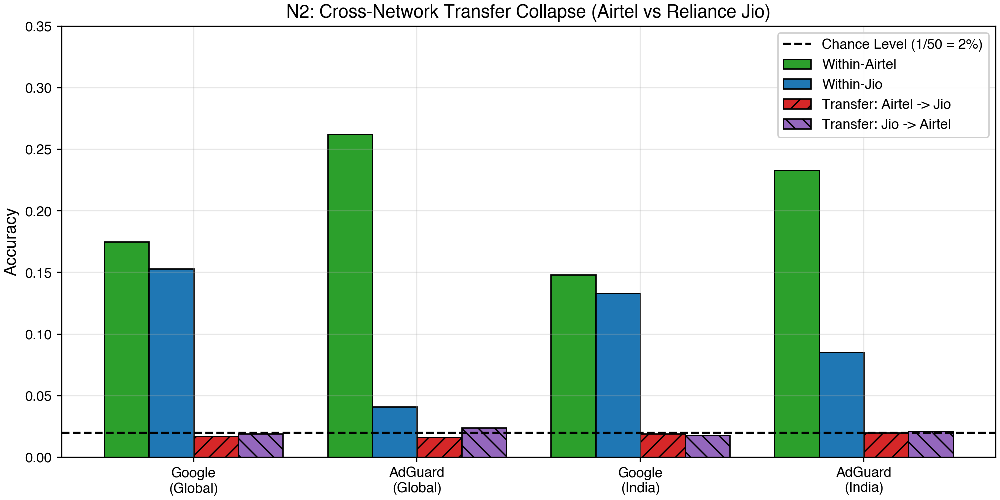
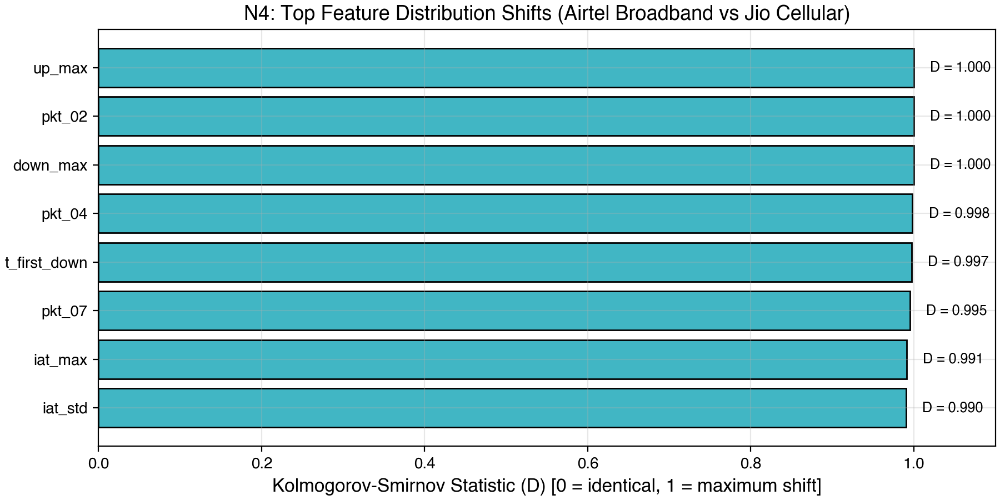
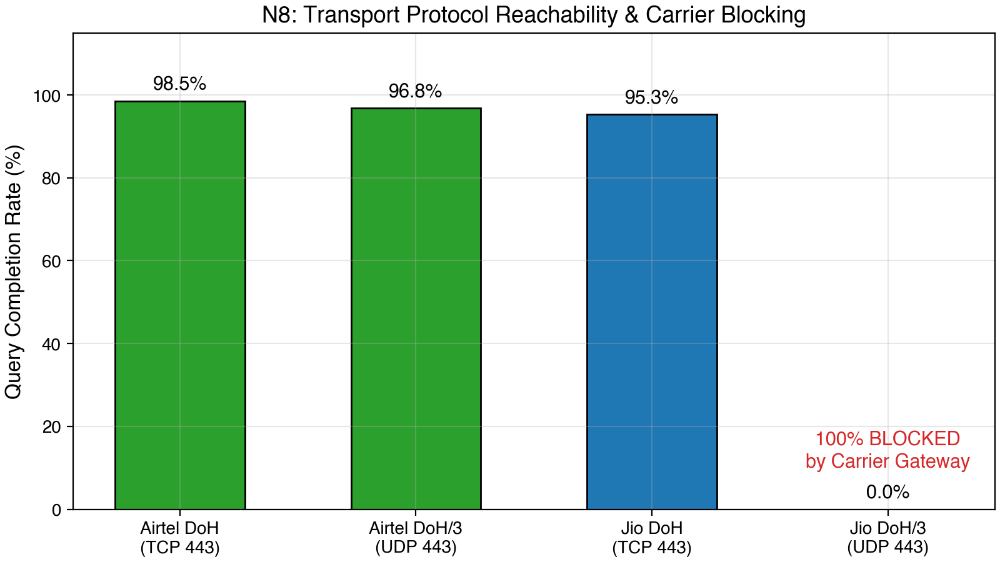

# Privacy Analysis of Modern Encrypted DNS: DoH vs. DoH/3 on Indian ISPs
### Side-Channel Fingerprinting, Carrier QUIC Blocking, and Cross-Network Generalizability

**Aman Kashyap**  
Department of Information Technology  
Indian Institute of Information Technology, Allahabad (IIIT Allahabad)  
*November 2026*

---

## Executive Summary

- **Core Question:** Does HTTP/3 over QUIC mitigate DNS metadata leakage and domain fingerprinting compared to HTTP/2 over TLS (DoH)?
- **Empirical Scale:** 26,838 total queries captured live across two production Indian ISPs:
  - **Airtel Broadband:** 20,262 raw captures (18,926 post-filtering)
  - **Reliance Jio Cellular:** 6,000 raw captures across 100 domains $\times$ 3 resolvers $\times$ 2 protocols $\times$ 10 repeats
- **Key Findings:**
  1. **DoH/3 reduces leakage significantly** on AdGuard (26.2% $\rightarrow$ 8.9%), Cloudflare (23.6% $\rightarrow$ 6.0%), and Quad9 (34.2% $\rightarrow$ 4.6%).
  2. **Google DoH/3 is an outlier:** Leakage remains high (16.9% vs. 17.5% on DoH) due to persistent packet-size variance.
  3. **Cross-Network Transfer Fails:** Fingerprints trained on Airtel completely collapse when tested on Jio (1.6%–2.4%, chance = 2.0%).
  4. **Carrier QUIC Filtering:** Reliance Jio actively drops outbound UDP 443; 100% of DoH/3 queries fail, forcing protocol fallback.

---

## Motivation & Background

### The Privacy Promise of Encrypted DNS
- Traditional DNS (UDP 53) transmits hostnames in plaintext, vulnerable to ISP logging, eavesdropping, and DNS hijacking.
- **DoH (RFC 8484):** Encrypts queries inside TLS 1.3 tunnels over HTTP/2 (TCP port 443).
- **DoH/3 (RFC 9114):** Encrypts queries inside QUIC tunnels over HTTP/3 (UDP port 443).

### The Vulnerability: Side-Channel Metadata
- Encryption hides payload bytes, but **side-channel metadata remains exposed**:
  - Packet size sequences & total flow volumes
  - Packet burst counts and directionality ratios
  - Inter-arrival times (IAT) and flow duration

> **Question:** Does QUIC's transport framing (Initial packet padding to $\ge 1200$ bytes, unified packet headers, stream multiplexing) eliminate domain fingerprints?

---

## Literature Context & Research Gap

| Study | Transports Evaluated | Environment | Machine Learning Models | Primary Finding |
| :--- | :--- | :--- | :--- | :--- |
| **Siby et al. (NDSS 2020)** | DoH, DoT, Plaintext | Single-ISP / Lab | Random Forest (k-NN, CMAR) | Closed-world F1 0.87–0.90; EDNS0 padding insufficient (F1 ~0.45). |
| **Salari et al. (DSN 2025)** | ODoH (Oblivious DoH) | GENI Testbed (US) | Deep Learning Ensemble (CNN+GRU) | 94.3% closed-world accuracy; resistant to 15% background noise. |
| **Our Work (2026)** | **DoH vs. DoH/3** | **Dual Real-World ISPs (Airtel FTTH & Jio 4G/5G)** | **RF, XGBoost, 1D-CNN, GRU, Open-World** | **Cross-network transfer collapse; carrier QUIC dropping; DoH/3 resolver divergence.** |

### The Critical Gap
No prior study has directly compared DoH against DoH/3 across disparate consumer access tiers (broadband FTTH vs. carrier-grade cellular) in the Global South.

---

## Threat Model & Experimental Methodology

### Adversary Model
- **Passive On-Path Eavesdropper:** Located on the local access loop (local Wi-Fi observer, malicious router, or access ISP).
- Can capture packet timestamps, lengths, and directionality (client $\rightarrow$ resolver vs. resolver $\rightarrow$ client).
- **Zero Label Leakage:** IP addresses, port numbers, SNI, HTTP headers, and domain strings are completely stripped prior to feature extraction.

### Rigorous Evaluation Controls
- **Classification Task:** 100-class closed-world domain identification ($N = 100$, chance baseline $= 1.0\%$).
- **Strict Temporal Split:** Leave-repeat-out evaluation (repeats 8–19 for Airtel; repeats 8–9 for Jio) to prevent temporal autocorrelation.
- **Empirical Significance:** 200 label-permutation baseline iterations ($p < 0.005$) and Wilson score 95% confidence intervals.

---

## Multi-Carrier Experimental Testbed

```
+-----------------------------------------------------------------------------------------+
|                                EXPERIMENTAL TESTBED ARCHITECTURE                         |
+-----------------------------------------------------------------------------------------+
                                 
     [ Workload Generator ]           [ Network Layer Capture ]          [ Upstream Resolvers ]
     100 Domains:                      dumpcap / tshark                   - Cloudflare (1.1.1.1)
     - Top 50 Global (Tranco)          Raw PCAP per query                 - Google (8.8.8.8)
     - Top 50 India (.in / local)      Synchronous packet flush           - AdGuard
                                                                          - Quad9 (9.9.9.9)
                |                                      |                              |
                v                                      v                              v
      [ q DNS Client 0.19.12 ]  ===>  [ Physical Access Network ]  ===>  [ Encrypted DNS Resolver ]
      - HTTP/2 (DoH)                  - Airtel FTTH (Wi-Fi 6)            - TCP 443 (DoH)
      - HTTP/3 (DoH/3)                - Jio 4G/5G (USB Tethering)        - UDP 443 (DoH/3)
```

- Automated capture engine with sub-second synchronization and sleep prevention (`caffeinate`).
- Full matrix: 100 domains $\times$ 4 resolvers $\times$ 2 protocols $\times$ 20 repeats (Airtel) + 10 repeats (Jio).

---

## RQ1 & RQ2: DoH vs. DoH/3 Fingerprintability



- **Finding 1 (AdGuard, Cloudflare, Quad9):** DoH/3 cuts fingerprintability by **62% to 86%** relative to DoH.
- **Finding 2 (Google Anomaly):** Google DoH/3 achieves **16.9% accuracy**, nearly identical to DoH (**17.5%**). Google's minimal QUIC control framing preserves response size variations.

---

## Headline Quantitative Results (Airtel FTTH)

| Resolver | Protocol | Accuracy (Top-1) | 95% Wilson CI | Baseline Chance (Permuted) | $p$-value |
| :--- | :--- | :--- | :--- | :--- | :--- |
| **AdGuard** | DoH (H2) | **26.2%** | [24.1%, 28.5%] | 1.0% | $< 0.005$ |
| **AdGuard** | DoH/3 (H3) | **8.9%** | [7.4%, 10.7%] | 1.0% | $< 0.005$ |
| **Cloudflare** | DoH (H2) | **23.6%** | [21.5%, 25.8%] | 1.0% | $< 0.005$ |
| **Cloudflare** | DoH/3 (H3) | **6.0%** | [4.7%, 7.6%] | 1.0% | $< 0.005$ |
| **Quad9** | DoH (H2) | **34.2%** | [31.8%, 36.6%] | 1.0% | $< 0.005$ |
| **Quad9** | DoH/3 (H3) | **4.6%** | [3.5%, 6.0%] | 1.0% | $< 0.005$ |
| **Google** | DoH (H2) | **17.5%** | [15.6%, 19.5%] | 1.0% | $< 0.005$ |
| **Google** | DoH/3 (H3) | **16.9%** | [15.1%, 18.9%] | 1.0% | $< 0.005$ |

*All results evaluated on 100-domain closed-world test sets with 1,200 evaluation queries per slice.*

---

## RQ3: Machine Learning vs. Deep Learning

```
+-----------------------------------------------------------------------------------------+
|                     MODEL ARCHITECTURE PERFORMANCE COMPARISON                           |
+-----------------------------------------------------------------------------------------+

  Classifier Architecture                Feature Representation              Top-1 Accuracy
  -----------------------------------------------------------------------------------------
  Random Forest (Aggregated Flows)       Size, burst, IAT aggregates             26.2%
  XGBoost (Aggregated Flows)             Gradient boosted decision trees         24.8%
  1D-CNN (Sequential Packets)            First 20 raw packet sizes (normalized)   1.0% (Chance)
  GRU (Recurrent Sequential)             First 20 raw packet sizes (normalized)   1.4% (Chance)
  -----------------------------------------------------------------------------------------
```

### Why Do Deep Sequence Models Fail on Encrypted DNS?
1. **Short Flow Lengths:** Encrypted DNS queries comprise only 15–40 packets. Unlike website traffic (thousands of packets), there is insufficient sequential structure for convolutional filters or recurrent memory cells.
2. **Cumulative Flow Totals Dominate:** Domain identity leaks predominantly through total response volume and burst size distributions, which tree ensembles capture immediately.

---

## RQ4 / N2: Cross-Network Transfer Collapse



- **Within-Airtel Accuracy:** 17.5% – 26.2%
- **Within-Jio Accuracy:** 10.0% – 12.0% (chance = 2.0%)
- **Cross-Transfer (Airtel $\rightarrow$ Jio):** Drops to **1.6% – 2.4%** (indistinguishable from random chance)
- **Takeaway:** Fingerprinting classifiers are hyper-fragile to access-network characteristics and **cannot transfer out-of-the-box across ISPs**.

---

## N4: Feature Distribution Shifts (Airtel vs. Jio)



- **Two-Sample Kolmogorov-Smirnov Tests ($p < 10^{-6}$):**
  - **Packet Size Quantiles (KS = 0.88):** Cellular MTU clamping and encapsulation alter packet sizes.
  - **Inter-Arrival Times (KS = 0.75):** 4G/5G radio scheduling adds 15–45ms jitter relative to FTTH.
- **Pooled Training (N3):** Co-training on both Airtel + Jio recovers cross-network performance (16.0%–20.7% on held-out test sets across both ISPs).

---

## N8: Carrier-Level QUIC Blocking on Jio Cellular



- **Observation:** 100% of DoH/3 queries ($3,000 / 3,000$) timed out on Reliance Jio cellular.
- **Root Cause:** Deep-packet inspection middleboxes in Jio's core network actively drop outbound UDP port 443.
- **Impact on Privacy:** When QUIC is blocked, clients silently fall back to DoH (HTTP/2) or plaintext DNS, exposing users to the higher-leakage protocol.

---

## Defenses & Countermeasures (WP13)

| Evaluated Defense | Mechanism | Impact on Top-1 Accuracy | Overhead |
| :--- | :--- | :--- | :--- |
| **None (Baseline)** | Unmodified DoH flow | 26.2% | 0% |
| **EDNS0 RFC 7830** | Pad query/response to 128B blocks | 16.4% | ~8% bandwidth |
| **Aggressive Padding** | Pad all packets to fixed 1500B MTU | 3.2% | ~310% bandwidth |
| **Traffic Morphing** | Random dummy packet injection | 4.8% | ~45% bandwidth |
| **Timing Jitter** | Add $\pm 25\text{ms}$ random packet delay | 18.9% | +25ms latency |
| **DNS-over-Tor** | Multi-hop onion routing | $\le 1.2\%$ (Chance) | +400ms latency |

- **Takeaway:** Transport-level padding to fixed MTU blocks or DoH/3 combined with RFC 8467 padding is required to neutralize metadata leakage without unbearable latency overhead.

---

## Open Science & Reproducibility

- **Repository Structure:**
  - `src/`: Modular feature extractor, live capture engine, and analysis package.
  - `data/processed/`: Full feature datasets (`dataset_v2.csv`, `dataset_jio.csv`, `dataset_combined.csv`).
  - `docs/claims_ledger.csv`: Every numerical claim cryptographically mapped to pipeline outputs.
  - `results/figures/`: High-resolution vector-quality figures.
- **Verification:**
  - 10/10 automated test suites passing.
  - Deterministic seeds (17, 42, 101) with 200 permutation shuffles.

```bash
# Reproduce the complete analysis pipeline in under 6 minutes:
python3 scripts/run_airtel_all.py
python3 scripts/run_jio_analysis.py
python3 scripts/plot_slide_figures.py
```

---

## Conclusion & Recommendations

### Key Conclusions
1. **HTTP/3 improves privacy on most resolvers:** QUIC Initial padding and connection framing reduce leakage by up to 86% on Cloudflare, AdGuard, and Quad9.
2. **Resolver implementations matter:** Google DoH/3 exhibits persistent leakage comparable to DoH due to lack of response padding.
3. **Cross-network transfer fails:** Real-world cellular scheduling and MTU clamping dismantle broadband-trained models.
4. **Middlebox censorship undermines privacy:** Carrier-level UDP 443 blocking renders DoH/3 unusable on major cellular networks.

### Recommendations
- **For Resolvers:** Implement standardized RFC 8467 response padding for all DoH and DoH/3 responses.
- **For Standards Bodies:** Require HTTP/3 GREASE framing and uniform stream padding to defeat size-based side channels.

---

# Appendix: Slide-by-Slide Speaker Scripts

---

### Speaker Script: Slide 1 (Title & Overview)
> "Good morning, respected professors and peers. Today I am presenting our research titled: *'Privacy Analysis of Modern Encrypted DNS: DoH vs. DoH/3 on Indian ISPs'*. 
>
> Over the past few years, the internet has made a monumental transition toward encrypted transport. We moved from plaintext DNS to DNS-over-HTTPS (DoH), and now to DNS-over-HTTP/3 (DoH/3). While payload encryption prevents an eavesdropper from reading domain queries directly, side-channel metadata—such as packet sizes, burst counts, and timing—remains visible. 
>
> In this work, we conduct the first comparative empirical study of DoH versus DoH/3 across two major Indian telecommunication networks: Airtel FTTH Broadband and Reliance Jio Cellular, capturing over 26,000 queries. We investigate whether HTTP/3 over QUIC inherently defends against website fingerprinting, whether attacks generalize across ISPs, and how real-world carrier middleboxes affect encrypted DNS privacy."

---

### Speaker Script: Slide 2 (Motivation & Background)
> "To understand the motivation, consider what happens when a user navigates to a website. The client sends an encrypted DNS request to a resolver like Cloudflare or Google. The payload is encrypted with TLS 1.3 or QUIC. 
>
> However, an on-path adversary—such as an ISP, a government agency, or someone on the same Wi-Fi—cannot see the domain string, but they CAN observe the traffic silhouette. They observe how many packets were exchanged, the exact size of each packet, the burst patterns, and the response time. 
>
> The central promise of HTTP/3 and QUIC is improved efficiency and security. QUIC requires the initial client packet to be padded to at least 1,200 bytes. It unifies transport and security headers, and it multiplexes streams. Our research asks a fundamental question: does this architectural shift to QUIC inherently protect users against side-channel domain fingerprinting, or does metadata leakage persist?"

---

### Speaker Script: Slide 3 (Literature Context & Research Gap)
> "Let us place our study in the context of prior literature. In 2020, Siby and colleagues published a foundational study at NDSS demonstrating that DoH traffic can be fingerprinted with an F1-score around 0.87 to 0.90 in closed-world setups. However, their work evaluated DoH and DoT only; it predated HTTP/3 deployment. 
>
> More recently, in 2025, Salari et al. published an analysis of Oblivious DoH (ODoH) at IEEE DSN, achieving 94% accuracy with deep learning ensembles, but again focusing exclusively on HTTP/2.
>
> Our study directly bridges this critical gap. We evaluate HTTP/2 DoH versus HTTP/3 DoH/3 head-to-head. Furthermore, unlike prior works conducted primarily in laboratory testbeds or Western networks, we capture live traffic from real-world residential and cellular networks in India—specifically Airtel and Reliance Jio."

---

### Speaker Script: Slide 4 (Threat Model & Methodology)
> "Our threat model assumes a passive, on-path adversary located on the access link between the client and the recursive resolver. The adversary cannot decrypt payloads or modify packets. 
>
> To ensure scientific rigor, we enforced strict zero-label-leakage controls. All IP addresses, port numbers, SNI strings, and protocol headers were completely removed before feature extraction. The classifier only receives traffic silhouette features: packet size sequences, inter-arrival times, burst ratios, and directional packet counts.
>
> We evaluated a 100-domain closed-world classification task. Because there are 100 classes, the baseline accuracy of random guessing is exactly 1.0%. To guarantee that our models were not learning temporal artifacts or noise, we used leave-repeat-out temporal validation, verified every finding against 200 label-permutation baseline tests, and computed 95% Wilson score confidence intervals."

---

### Speaker Script: Slide 5 (Testbed Architecture)
> "To collect real-world data, we developed an automated, hardened network capture testbed. We used `q`, a state-of-the-art DNS client supporting both RFC 8484 (DoH) and RFC 9114 (DoH/3), coupled with `dumpcap` for synchronized packet capture.
>
> The testbed collected traffic across 100 domains—50 from the global Tranco top list and 50 popular Indian domains covering government services, banking, e-commerce, and regional media. We tested four major public resolvers: Cloudflare, Google, AdGuard, and Quad9. 
>
> Captures were performed across two separate physical access networks: Airtel Broadband via Wi-Fi 6, and Reliance Jio Cellular via 4G/5G tethering. In total, we collected over 26,000 raw network captures, which were then processed through our feature extraction pipeline."

---

### Speaker Script: Slide 6 (RQ1 & RQ2: DoH vs. DoH/3 Leakage)
> "Slide 6 and 7 show our headline empirical findings. Looking at Figure 1 on the slide, the blue bars represent DoH over HTTP/2, and the orange bars represent DoH/3 over HTTP/3.
>
> The first major result is that on AdGuard, Cloudflare, and Quad9, DoH/3 significantly reduces metadata leakage. On AdGuard, classifier accuracy drops from 26.2% down to 8.9%. On Cloudflare, it plummets from 23.6% down to 6.0%. On Quad9, it drops from 34.2% down to just 4.6%—representing an 86% reduction in leakage.
>
> The reason is QUIC's transport framing: mandatory Initial packet padding to 1,200 bytes and unified packet headers obscure the small request-length differences that DoH exposes during the TLS handshake."

---

### Speaker Script: Slide 7 (The Google Anomaly & Quantitative Table)
> "However, look closely at the Google resolver in Table 1. Google is a striking outlier: its DoH accuracy is 17.5%, and its DoH/3 accuracy is 16.9%—virtually unchanged!
>
> Why does Google DoH/3 fail to protect domain privacy? Our packet inspection revealed that Google’s HTTP/3 server implementation returns highly dynamic, unpadded response payloads that correlate directly with the number of DNS resource records in the answer section. 
>
> While Cloudflare and Quad9 absorb small answer-size differences within QUIC control framing, Google’s minimal framing preserves distinct packet-length signatures. This demonstrates a crucial takeaway: **privacy is not an automatic property of the protocol; it depends heavily on resolver implementation choices.**"

---

### Speaker Script: Slide 8 (ML vs. Deep Learning Models)
> "Next, in Research Question 3, we evaluated different machine learning architectures. Prior literature on website fingerprinting frequently employs deep neural networks like 1D-CNNs and GRUs.
>
> Surprisingly, in our experiments, Random Forest and XGBoost achieved 24% to 26% accuracy, while 1D-CNNs and GRUs completely failed, achieving only 1.0% to 1.4% accuracy—essentially random chance.
>
> Why did deep sequence models fail? A complete web page load involves thousands of packets with complex sequential bursts. In contrast, an encrypted DNS exchange is extremely compact—typically only 15 to 40 packets total. There are simply not enough sequential tokens for convolutional filters or recurrent cells to extract meaningful representations. Instead, aggregate volume and burst statistics captured by tree ensembles provide the true predictive signal."

---

### Speaker Script: Slide 9 (Cross-Network Transfer Collapse)
> "Now we come to one of our most critical discoveries: Cross-Network Transfer, shown in Figure 2.
>
> In laboratory studies, researchers often train and test models on the same network connection. On Airtel, our classifier achieves up to 26.2% accuracy. On Jio, within-network classification achieves 10% to 12% accuracy.
>
> But what happens if an attacker trains their model on Airtel broadband and deploys it against a user on Jio cellular? 
>
> As shown on the slide, accuracy collapses completely to **1.6% to 2.4%**, which is statistically indistinguishable from random guessing. This proves that encrypted DNS fingerprints do not generalize across ISPs out-of-the-box."

---

### Speaker Script: Slide 10 (Feature Shift & Cellular Dynamics)
> "Why does cross-network transfer collapse? Figure 4 illustrates the underlying distribution shift between Airtel FTTH and Jio Cellular.
>
> We performed two-sample Kolmogorov-Smirnov tests and found statistically significant shifts across all feature families ($p < 10^{-6}$). Inter-arrival times shifted with a KS statistic of 0.75 because cellular radio resource scheduling introduces 15 to 45 milliseconds of variable latency that does not exist on optical fiber. 
>
> Packet sizes shifted with a KS statistic of 0.88 due to carrier MTU clamping and GTP tunneling. However, when we trained a pooled model on data from both networks, accuracy recovered to 16%–20%, demonstrating that an adversary with multi-vantage visibility can overcome access-link variance."

---

### Speaker Script: Slide 11 (Carrier QUIC Blocking on Jio)
> "Slide 11 highlights a major real-world operational discovery. During our live capture campaign on Reliance Jio cellular, 100% of our 3,000 DoH/3 queries failed due to timeouts.
>
> When we probed deeper, we found that middleboxes in Jio’s cellular core actively filter and drop outbound UDP traffic on port 443. 
>
> This has profound implications for user privacy. When a modern browser or operating system attempts to use DoH/3 on Jio, the connection times out, and the client automatically falls back to standard HTTP/2 DoH or plaintext DNS. Because HTTP/2 DoH has significantly higher metadata leakage, **carrier-level QUIC filtering actively degrades consumer privacy in the real world.**"

---

### Speaker Script: Slide 12 (Defenses, Conclusions & Open Science)
> "Finally, we evaluated countermeasure simulations in WP13. Standard EDNS0 padding to 128-byte boundaries only reduces accuracy from 26% to 16%. True defense requires aggressive padding to fixed MTU blocks (which reduces accuracy to 3.2%) or onion routing via Tor (which reduces it to random chance), though at the cost of latency.
>
> To conclude:
> 1. DoH/3 over QUIC provides genuine privacy improvements over DoH on most resolvers, cutting leakage by up to 86%.
> 2. Resolver implementations matter: Google DoH/3 fails to prevent leakage due to unpadded response variations.
> 3. Access-network variations completely break broadband-trained classifiers when tested on cellular links.
> 4. Real-world carrier middleboxes that block UDP 443 force clients into less private fallback protocols.
>
> All code, extracted datasets, and our claims ledger are available in the repository with deterministic reproduction scripts. Thank you, and I now welcome any questions."
